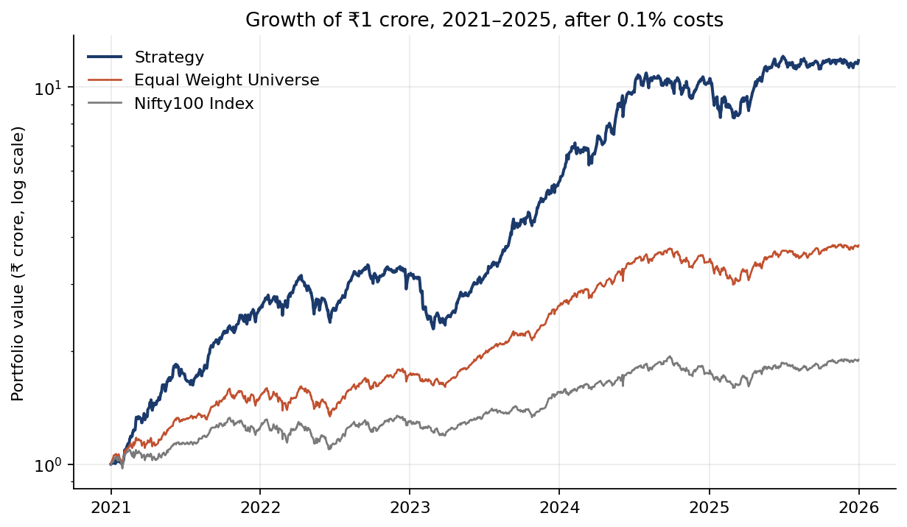

# Momentum on Indian equities: a pre-registered backtest

A 12-1 momentum rule holding 10 stocks from the Nifty 100 and Nifty Midcap 100 turned ₹1 crore
into ₹11.76 crore over 2021–25 after 0.1% transaction costs; none of the other 58 configurations
tested, each pre-registered with its predictions, did better.

Built for the Finesse × Citadel Round 2 portfolio construction challenge. **The rule:** rank every
eligible stock by its return from 252 to 21 trading days ago, measured through yesterday's close;
buy the top 10 in equal weight at the next open; repeat on the first trading day of each month.
There is no optimiser, no risk overlay and no fitted parameter.

## Results

| Result | Value | Source |
|---|---|---|
| Submitted rule, 1 Jan 2021 – 31 Dec 2025, net of costs | Total Net PNL **₹10,76,49,806** (+1,076.5%) · CAGR 63.78% · Sharpe 2.42 · max drawdown −32.40% | [`numbers.md` §1](output/report/numbers.md) |
| Benchmarks, same window | Equal-weight universe (costed) +280.55% · Nifty 100 index +89.41% | [`numbers.md` §2](output/report/numbers.md) |
| Against 10,000 random 10-stock books, same engine and dates | **0 of 10,000 beat it** on PNL · 96th percentile on return per unit of risk | [`numbers.md` §3](output/report/numbers.md) |
| Same rule on the universe as it stood on each date (quarterly baseline) | +388.0% against +876.5%: **488 percentage points of index-inclusion bias** in the mandated universe · still beats 9,996 of 10,000 random books | [`point_in_time/`](output/report/point_in_time/README.md) |
| Everything else tried: 58 configurations | **None beat it.** Three-feature composite signal: −5.15σ to −7.49σ · 0 of 42 composite weightings beat the baseline · adding Nifty Smallcap 100: ₹4.39 crore less | [`configurations.md`](output/report/configurations.md) |
| Out of sample, 1 Jan – 30 Jun 2026 (rejection filter only) | +7.60% against Nifty 100 −6.65% · 88.9th percentile of a fresh random band | [`numbers.md` §6](output/report/numbers.md) |

Also: accuracy 62.5% · gain-to-loss 2.01 · 168 round trips across 83 names · turnover 7.36× a year
· costs ₹20,59,816. σ is the standard deviation of the quarterly baseline's 10,000-draw band.



## Limitations

- **The mandated universe looks forward, and the effect is large.** The organisers specified today's index
  constituents for the whole window. A stock is in today's Nifty 100 partly because it rose, and
  firms that fell out are absent. On a point-in-time universe the quarterly baseline returns +388.0%
  instead of +876.5%. The rule itself has no look-ahead: signals use data through t−1, and
  `tests/test_causality.py` enforces it.
- **It maximises the scored metric, not suitability for real money.** Ranking was on raw PNL, so the
  book is 10 names, fully invested, with no drawdown control, and it takes a −32.4% drawdown. A live
  book would need position limits, sector caps and a fuller cost model than a flat 0.1%.
- **One window, one regime.** 2021–25 was an exceptional period for Indian mid-caps. The
  out-of-sample check is six months long.
- **Price return only.** Dividends are excluded, which understates a dividend-reinvesting book by
  about 9 percentage points (`docs/DECISIONS.md` A2).
- **Data approximations.** Yahoo Finance prices, which Yahoo revises. Two demergers are exited before
  the ex-date rather than adjusted. Share counts are floored on back-adjusted prices.

Full list: `docs/PROJECT.md` §10. What a live book would change: [`WALKTHROUGH.md`](WALKTHROUGH.md) §8.

## How the results are checked

- **A noise band sets the bar.** 10,000 random 10-stock books run through the same engine, universe,
  dates and costs (fixed seed `20260824`). A change smaller than the band's spread is treated as luck.
- **Pre-registration.** Every slate of trials was written into `docs/PROJECT.md` §11, with
  predictions, before it ran. Failed predictions are recorded as failed.
- **Causality is tested.** One test scrambles every price from the rebalance date onward and requires
  the selected book to be unchanged. A second scrambles the formation window, to show the first
  test is not vacuous.
- **Accounting reconciles.** The trade log explains the NAV to within ₹1, asserted on every run.
  Every parameter lives in `config.yaml`, and an unresolved decision raises an error instead of
  falling back to a default.

## Repository map

```
README.md, WALKTHROUGH.md   this file; the project explained without code, every trial included
config.yaml                 every parameter
requirements.txt            pinned package versions (Python 3.12)

src/                        the library
  calendar.py  universe.py  membership.py   trading days, eligibility, point-in-time membership
  clean.py  events.py                       panel build, corporate actions, forced exits
  features.py  select.py                    signals, ranking
  backtest.py  metrics.py  noise.py         execution and costs, reported metrics, the random band
  config.py  decisions.py  fetch.py         config validation, error types, network (isolated)
scripts/                    numbered pipeline steps (table below)
tests/                      125 tests: causality, accounting, cleaning, selection, config, scripts

output/report/              generated numbers, composition, all 63 runs, point-in-time run
output/figures/             four generated charts
data/                       constituent lists, overrides with evidence, NSE press releases,
                            generated data-quality report (price snapshots are not committed)
docs/                       PROJECT (mandate, method, trial ledger), DECISIONS (61 entries),
                            NOTES (analysis notebook), PLAN (closed V1 plan), archive/
presentation/               Finsearch_jury_deck.pdf (final jury-round deck); draft/ (earlier HTML draft)
```

## Setup and reproduce

**Quick check (offline, about 5 s):**

```bash
python3 -m pip install -r requirements.txt
python3 -m pytest tests/ -q        # 125 tests; 19 skip until the price snapshot is fetched
```

**Headline result from scratch (about 6 minutes; needs network for the first two steps):**

```bash
python3 scripts/01_fetch.py --as-of 2026-08-24          # prices + constituent lists   ~3 min
python3 scripts/08_pit_universe.py --as-of 2026-08-28   # historical index members     ~2 min
python3 scripts/02_clean.py --as-of 2026-08-28          # validated panel              ~30 s
python3 scripts/03_v0.py --calendar monthly_first_trading_day --weighting reset   #     ~5 s
python3 scripts/06_report.py                            # report pack and figures      ~10 s
```

Step 4 prints, among other lines:

```
[v0] 60 rebalances, 2021-01-01 -> 2025-12-01 | eligible names 174-192
[v0] reconciled: the trade log explains the NAV to within Rs 1
  Total Net PNL       Rs        107,649,806   ( 1076.5%)
```

| Script | Regenerates | Runtime |
|---|---|---|
| `03_v0.py` (no flags) | quarterly baseline → `output/*.csv` | ~5 s |
| `03_v0.py --calendar monthly_first_trading_day --weighting reset` | submitted run → `output/sweep/monthly_reset/` | ~5 s |
| `04_noise.py` (same flags) | 10,000-draw band → `noise_summary.csv` in the run's directory | ~6 s |
| `06_report.py` | `output/report/numbers.md`, `composition.md`, `output/figures/*.png` | ~10 s |
| `07_sweep.py` | cadence × weighting grid, 8 cells → `output/sweep/summary.csv` | ~7 min |
| `12_signal_sweep.py` | lookback × skip grid, 6 cells → `output/sweep/sig_summary.csv` | ~15 s |
| `05_v1.py`, `10_weight_sweep.py` | composite-signal arms and 42-cell weight surface → `output/v1/` | ~2 min |
| `11_smallcap_universe.py` | Smallcap 100 snapshot for the A19 arm (network) | network |
| `09_feature_diagnostics.py` | feature correlations, no PNL → `output/diagnostics/` | ~2 s |
| `13_config_ledger.py` | `output/report/configurations.md` and `.csv`, from all run directories | ~1 s |

For the point-in-time run, see [`output/report/point_in_time/`](output/report/point_in_time/README.md).
Yahoo revises history, so a fresh fetch may not be byte-identical to the 2026-08 snapshots. The
committed [`data/reports/data_quality.md`](data/reports/data_quality.md) records every count the
panel was validated on, so compare against it first.

## Reports

- [`WALKTHROUGH.md`](WALKTHROUGH.md): how the project was explored and every configuration tried, in order
- [`output/report/numbers.md`](output/report/numbers.md): every required metric, the noise band, liquidity and the 2026 window
- [`output/report/configurations.md`](output/report/configurations.md): all 63 runs in one table ([CSV](output/report/configurations.csv))
- [`output/report/composition.md`](output/report/composition.md): holdings and weights
- [`docs/DECISIONS.md`](docs/DECISIONS.md): every design decision and its reasoning, reversals included
- [`docs/PROJECT.md`](docs/PROJECT.md): the mandate, method and full trial ledger (§11)
- [`docs/NOTES.md`](docs/NOTES.md): mechanism analysis and bug hunts

## Status

Complete. Strategy work closed on 2 Sep 2026 with the monthly configuration frozen
(`docs/PROJECT.md` §15), and no further runs are planned. The 5–6 page written report is not
in this repository.
